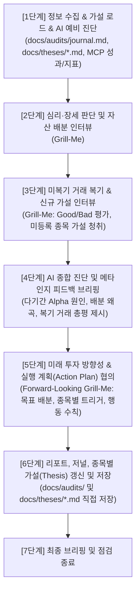

# 자산 점검 및 투자 복기 스킬 (asset-auditor)

## 1. 기본 원칙 및 태도
- **원격 MCP 전용 데이터 획득 (Positive Guardrails)**:
  - 모든 포트폴리오 데이터는 오직 `assetmanager` 원격 MCP 도구(`get_benchmark_attribution`, `get_asset_summary`, `get_asset_ratios`, `get_transactions`, `get_market_history` 등)를 호출하여 서버의 최신 상태를 직접 획득한다.
- **레포지토리 내부 단일 진실 공급원 (SSOT)**:
  - 감사 결과물 및 종목별 투자 가설은 **레포지토리 내부(`docs/`)**에 직접 저장하고 관리한다.
    - **마스터 저널**: `docs/audits/journal.md`
    - **회차별 상세 리포트**: `docs/audits/reports/YYYYMMDD_HHMMSS.md`
    - **종목별 투자 가설**: `docs/theses/{TICKER}_{종목영문명}.md` 및 색인 `docs/theses/README.md`
  - 단, 텔레그램 발행 시장/자산 정기 보고서 탐색은 `uv run python scripts/get_storage_dir.py`를 실행하여 획득한 `STORAGE_DIR/reports/`를 참조한다.
- **엄격한 1질의 1답 (Grill-Me 인터뷰)**:
  - 한 번에 단 하나의 명확한 질문만 던지고 사용자의 답변을 대기한다. 모호한 답변에는 구체적 수치와 근거를 즉시 재질의한다.
- **비판적 가설 감사 (Thesis Auditor)**:
  - `docs/references/investment-principles.md`를 로드하여 핵심 원칙(독립적 Thesis, 대중 센티먼트 역발상, 자산 배분 통제) 부합 여부를 검증하고, 타인 추천이나 단순 소음(매크로/뉴스/차트) 추종 매매는 Bad Trade(🔴)로 비판적 피드백을 제시한다.
- **사례 기반 검증 (On-Demand Cases)**:
  - 장세 판단(2단계) 및 매매 복기(3단계) 시, `docs/references/trade-cases-index.md` 색인을 조회하고 매칭되는 `docs/references/cases/*.md`를 로드하여 객관적 근거 및 과거 교훈으로 인용한다.

---

## 2. 자산 점검 및 투자 복기 워크플로우 (7단계 파이프라인)



---

### [1단계] 정보 수집, 가설 로드 및 AI 예비 진단
1. **저널 및 가설 로드**:
   - `docs/audits/journal.md` 조회 ➔ `LAST_AUDIT_DATE`, **'현재 활성 전략(Active Strategy)'** 및 **'직전 실행 계획(Action Plan)'** 확인 (파일이 없거나 미기재 시 30일 전 기본값)
   - `docs/theses/` 디렉터리의 종목별 가설 파일 목록 및 내용 로드
2. **미참조 시장/자산 보고서 계층적 탐색 및 로드**:
   - `uv run python scripts/get_storage_dir.py` 실행 ➔ `STORAGE_DIR` 획득
   - `STORAGE_DIR/reports/` 디렉터리에서 `LAST_AUDIT_DATE` 이후 발행된 보고서를 다음 계층 순으로 수집:
     1) **월간 보고서**: `STORAGE_DIR/reports/asset_monthly/Asset_monthly_report_YYYYMM.md`
     2) **주간 보고서**: `STORAGE_DIR/reports/{korea_market,us_market}/weekly/*.md`
     3) **일간 보고서**: `STORAGE_DIR/reports/{korea_market,us_market}/daily/*.md`
   - 핵심 요약을 예비 진단 컨텍스트로 통합
3. **다기간 벤치마크 성과 수집**:
   - `get_benchmark_attribution` MCP 도구를 호출하여 4대 기간(1M, 3M, 1Y, YTD) 벤치마크 수익률(포트폴리오, S&P 500, NASDAQ, KOSPI) 및 초과수익률(`Alpha = portfolio - sp500`) 수집
4. **보유 종목별 다기간 성과 및 기여도(Top/Bottom 3) 분석**:
   - `get_benchmark_attribution` 데이터에서 실제 발생 손익(Actual P&L) 기반 Top 3 기여 종목(`top_contributors_*`) 및 Top 3 부진 종목(`top_detractors_*`) 도출
   - 단순 주가 등락률이 아닌 **자본 손익(`capital_pnl`)과 배당/이자 손익(`dividend_pnl`), 총 손익(`total_pnl`), 원화 보조 손익(`*_krw`)**을 분리 분석
   - 내 포지션 실제 수익률(`capital_returns`, `returns`)과 단순 시장 주가 등락률(`price_returns`)을 대조하여 매매 타이밍 및 중도 매수(물타기/불타기) 효과 확인
   - 미국 종목(USD)은 USD 기본 손익과 기준일 환율 적용 원화 보조 손익(`*_krw`)을 함께 고려
   - **기간 중 전량 매도 종목(`status: CLOSED`, `weight: 0.0%`)**도 기간 내 매매 및 손익이 발생한 경우 Top/Bottom 기여도에 포함되므로, 과거 손절매/익절매 거래가 감사에서 누락되지 않도록 식별
   - 전체 대상 종목과 `docs/theses/` 가설 등록 여부를 대조하여 **'가설 미등록 종목'** 식별 플래그 설정
5. **자산 배분 비중 및 시장 지표 수집**:
   - `get_asset_ratios` 호출 ➔ 자산군별 배분 비중 파악
   - `get_market_history` 호출 ➔ S&P 500 고점 대비 MDD 및 최근 20거래일 VIX 지표 확인
6. **AI 성과 원인 분석 4대 레이어 (Attribution Analysis)**:
   - **Cash Drag 효과**: 현금/달러 비중에 따른 시장 대비 성과 영향
   - **보유 종목 기여도**: Top/Bottom 기여 종목의 포트폴리오 영향 (자본 손익 vs 배당 손익 구분)
   - **시장/국가 노출도**: 한국(KOSPI) vs 미국(S&P 500) 비중에 따른 지수 영향
   - **원칙 준수 및 매매 행태**: 미복기 거래 내역(`get_transactions`) 대조
7. **예비 진단 브리핑 및 첫 번째 질의**:
   - `[다기간 벤치마크 성과 비교]` 표 및 `[보유 종목 다기간 성과 및 기여도]` 표 출력
   - **[보유 종목 다기간 성과 및 기여도] 표 작성 가이드라인 (3대 원칙)**:
     ① **자본 수익과 배당/세금 수익 분리**: 순수 주가 변동에 따른 자본 손익/수익률(`capital_pnl`, `capital_return`)과 세후 배당/이자 손익(`dividend_pnl`)을 구분 표기하여 채권 ETF 및 배당주의 현금흐름 기여도를 투명하게 반영합니다.
     ② **미국 종목(USD) 기본 통화 및 KRW 환산 보조 병기**: 미국 주식은 순수 USD 손익을 기본으로 표기하고 원화 환산액(`*_krw`)을 병기합니다 (예: `+$150 (₩202,500) / +3.10%`).
     ③ **전량 매도(CLOSED) 종목 누락 방지**: 분석 기간 중 전량 매도되어 기준일 현재 보유 수량이 0주인 종목도 `CLOSED (0.0%)`로 상태를 명시하고 표에 포함하여, 기간 수익률을 깎아먹거나 기여한 매매가 감사에서 증발하지 않도록 합니다.

     ```markdown
     | 구분 | 종목명 (티커) | 상태 (비중) | 1M 자본손익 (수익률) | 1M 배당손익 | 1M 총기여도 | YTD 자본손익 (수익률) | YTD 배당손익 | YTD 총기여도 | 가설 문서 |
     | :--- | :--- | :---: | :---: | :---: | :---: | :---: | :---: | :---: | :--- |
     | **Top 기여 (1M)** | TLT (미국장기채) | HOLDING (6.72%) | +$150 (₩202,500) / +3.10% | +$50 (₩67,500) | **+0.28%p** | -$200 (₩270,000) / -4.20% | +$120 (₩162,000) | -0.15%p | 안전자산 |
     | **Top 기여 (1M)** | PFE (화이자) | HOLDING (3.74%) | +$180 (₩243,000) / +6.20% | +$25 (₩33,750) | **+0.26%p** | +$600 (₩810,000) / +20.50% | +$110 (₩148,500) | +0.91%p | 배당/가치 |
     | **Top 부진 (1M)** | SK하이닉스 (`000660`) | HOLDING (7.73%) | -150만 / -22.28% | +5만 | **-1.86%p** | +890만 / +115.49% | +15만 | +8.93%p | [000660_SK_Hynix.md](file:///c:/localrepo/AssetManager/docs/theses/000660_SK_Hynix.md) |
     | **Top 부진 (YTD)** | KODEX 200 (`069500`) | **CLOSED (0.0%)** | 0원 / 0.0% | 0원 | 0.0%p | -50만 / -10.00% | 0원 | **-0.69%p** | 가설 미등록 (손절 청산) |
     ```
   - 4대 레이어 원인 분석 브리핑 후, 2단계 진입을 위한 첫 번째 Grill-Me 질문 단 1건을 출력하고 사용자 답변 대기
- **완료 검증 조건 (Checkable Completion Criteria)**:
  - [ ] `docs/audits/journal.md`와 `docs/theses/`를 로드하고 가설 미등록 종목 유무를 식별했는가?
  - [ ] `get_benchmark_attribution`, `get_asset_ratios`, `get_market_history`를 정상 호출했는가?
  - [ ] 성과 비교 표와 첫 번째 Grill-Me 질문 1건이 온전히 출력되어 입력을 대기 중인가?

---

### [2단계] 심리·장세 판단 및 자산 배분 인터뷰 (Grill-Me)
1. **사용자 답변 대조 및 피드백 (1질의 1답)**
2. **다기간 성과 및 알파(Alpha) 연계 질의**:
   - 🟢 `Alpha > 0` (시장 상회): 특정 급등주 쏠림 여부 점검 및 과열 국면 분산/현금 리밸런싱 계획 질의
   - 🔴 `Alpha < 0` (시장 하회): 부진 종목(Detractors) 쏠림, 코어 부족, 공포 투매 여부 질의
3. **부진 종목 모멘텀 및 가설 훼손 여부 질의**:
   - 최근 급락 종목의 `docs/theses/{TICKER}.md` 가설 훼손 여부 및 비중 조절 계획 질의
4. **시장 센티먼트 및 동적 리밸런싱 준수 점검**:
   - MDD 및 VIX 수치를 `docs/references/investment-principles.md`의 동적 리밸런싱 기준과 대조하여 전략 질의
- **완료 검증 조건 (Checkable Completion Criteria)**:
  - [ ] Alpha 원인(포트폴리오 수익률 견인/부진 요인), 부진 종목 가설 훼손 여부, 시장 센티먼트에 대해 1질의 1답 인터뷰를 완결했는가?
  - [ ] 동적 리밸런싱 기준 부합 여부 및 차기 자산 배분 스탠스를 확정했는가?

---

### [3단계] 미복기 거래 복기 및 신규 가설 인터뷰 (Grill-Me)
1. `get_transactions`로 `LAST_AUDIT_DATE` 이후의 미복기 BUY/SELL 거래 필터링
2. 거래가 없는 경우: "미복기 거래 없음"을 확인하고 4단계로 즉시 이동
3. 거래가 있는 경우 시간순 1건씩 릴레이 인터뷰 수행:
   - **가설 및 센티먼트 검증**: 독립적 펀더멘털 가설, 당시 센티먼트, 목표 배분 부합 여부 질의
   - **소음 및 원칙 대조**: [원칙 2.3] 2주 매매 간격 준수 여부, 소음 추종 여부 검증
   - **거래 등급 부여**: 🟢 Good Trade / 🔴 Bad Trade / 🟡 Hold
4. **미등록 종목 가설 인터뷰**:
   - 최근 매수 종목 중 `docs/theses/`에 파일이 없는 경우, **독립적 펀더멘털 가설(핵심 팩트/논리, 소음 구분, Exit 트리거)**을 즉석 인터뷰하여 신규 가설 내용을 확보
- **완료 검증 조건 (Checkable Completion Criteria)**:
  - [ ] 미복기 거래가 없음을 확인했거나, 존재하는 모든 미복기 거래에 대해 릴레이 인터뷰 및 등급(🟢/🔴/🟡) 부여를 완결했는가?
  - [ ] 신규 매수 종목이 존재하는 경우 독립적 가설(Core Thesis & Exit Trigger)을 빠짐없이 청취했는가?

---

### [4단계] AI 종합 진단 및 메타인지 피드백 브리핑
- **목적**: 복기 직후 실행 계획으로 넘어가기 전, 이번 점검 결과에 대한 AI의 종합적인 메타인지 진단 총평을 제시하여 객관적 자기인식을 확립한다.
- **진행 규칙**: 본 단계에서는 사용자에게 질문을 던지지 않고 순수 단독 브리핑으로 완결하며, 브리핑 말미에 5단계 진입 안내 문구만 출력한 뒤 사용자 확인 입력을 대기한다.
- **브리핑 구성**:
  1. **다기간 성과 및 Alpha 총평**: 포트폴리오가 시장을 상회/하회한 핵심 구조적 원인 (예: 코어 부족, 특정 종목 과다 노출, 현금 드래그 등)
  2. **자산 배분 정합성 진단**: 평시 7:3 및 주식 내 6:3:1(코어:알파:배당) 원칙 준수율과 왜곡 상태 진단
  3. **매매 복기 종합 평가**: 복기된 거래들의 원칙 준수율(Good Trade vs Bad Trade 비율) 및 심리적 약점(FOMO, 물타기 조급증 등) 비판적 지적
  4. **원칙 개선 핵심 제언**: 차기 운용에서 반드시 시정해야 할 핵심 원칙 권고
- **완료 검증 조건 (Checkable Completion Criteria)**:
  - [ ] 사용자 질의 없이 1~3단계 결과를 종합한 AI 단독 메타인지 피드백 브리핑이 완결되었는가?
  - [ ] 브리핑 하단에 "이 진단을 바탕으로 미래 투자 방향성과 실행 계획(Action Plan)을 논의하겠습니다" 안내가 포함되었는가?

---

### [5단계] 미래 투자 방향성 및 차기 대응 전략 협의 (Forward-Looking Grill-Me)
- **목적**: 4단계 AI 진단 피드백을 기반으로, 다음 점검까지의 구체적이고 실행 가능한 투자 계획을 1:1 인터뷰로 확정한다.
- **핵심 협의 항목**:
  1. **자산 배분 조정 계획 (Target Allocation)**:
     - 왜곡된 비중(예: 과도한 알파 비중, 코어 지수 부족)을 정상화하기 위한 구체적 목표 비율 및 조정 시기
  2. **종목별 대응 및 매매 트리거 조건 (Stock-Specific Triggers)**:
     - 보유 종목별 향후 스탠스 (장기 보유, 반등 시 분할 매도 교체, 가설 훼손 모니터링 등)
     - 구체적 트리거 조건(예: 특정 가격/밸류에이션 도달 시 분할 매도, 가설 훼손 지표) 확정
  3. **차기 점검까지의 행동 수칙 (Do's & Don'ts)**:
     - [원칙 2.3] 쿨링다운(2주) 준수, 금기 매매(충동 물타기 등), 대기 조건 명시
- **완료 검증 조건 (Checkable Completion Criteria)**:
  - [ ] 목표 자산 배분, 종목별 트리거 조건, 차기 점검까지의 행동 수칙이 모호함 없이 구체적 수치로 합의되었는가?

---

### [6단계] 통합 보고서, 저널, 종목별 가설(Thesis) 갱신 및 레포 직접 저장
1. **회차별 상세 보고서 저장**:
   - `docs/audits/reports/YYYYMMDD_HHMMSS.md` 신규 생성
   - 포함 내용: 현재 활성 전략, 벤치마크 성과 표, 종목 기여도 표(`[보유 종목 다기간 성과 및 기여도 요약]` - 자본/배당 분리, 미국 종목 USD(KRW 병기), 전량 매도 CLOSED 포함 원칙 적용), 종목 가설 상태, 복기 거래 내역 및 등급, **미래 투자 방향성 및 실행 계획(Action Plan)**
2. **마스터 저널 갱신**:
   - `docs/audits/journal.md` 파일 업데이트
   - 최상단 `# 현재 활성 전략 및 향후 대응 계획 (Active Strategy & Action Plan)` 섹션 최신화
   - `### [다기간 벤치마크 성과 비교]` 및 `### [보유 종목 다기간 성과 및 기여도 요약]` 최신 데이터로 교체 (1단계 표 작성 3대 원칙 준수)
   - `# 회차별 감사 및 복기 이력 (Audit History)` 최상단에 이번 회차 요약 블록 누적 삽입
3. **종목별 가설 파일 갱신 및 신규 생성**:
   - 5단계에서 합의된 포지션 관리/트리거 내용을 해당 `docs/theses/{TICKER}_{종목영문명}.md`의 `## 3. 포지션 관리 및 미래 실행 계획` 및 `## 5. 회차별 가설 갱신 및 복기 이력`에 반영
   - 신규 종목의 경우 템플릿에 맞추어 `docs/theses/{TICKER}_{종목영문명}.md` 신규 생성 및 `docs/theses/README.md` 목록에 추가
- **완료 검증 조건 (Checkable Completion Criteria)**:
  - [ ] `docs/audits/reports/YYYYMMDD_HHMMSS.md` 파일이 정상 생성되었는가? (종목 기여도 표의 자본/배당 분리 및 CLOSED 종목 포함 여부 확인)
  - [ ] `docs/audits/journal.md` 상단 전략/액션플랜 및 하단 이력이 온전히 갱신되었는가?
  - [ ] 관련된 `docs/theses/*.md` 가설 파일의 액션플랜 및 이력이 정확히 업데이트되었는가?

---

### [7단계] 최종 브리핑 및 워크플로우 종료
- 이번 감사 결과 확정된 핵심 Action Plan(자산배분 목표, 종목별 트리거, 다음 매매 가능일)을 요약 안내하고 워크플로우를 종료한다.
- **완료 검증 조건 (Checkable Completion Criteria)**:
  - [ ] 확정된 Action Plan 핵심 3대 수칙이 사용자에게 명확히 전달되었는가?
  - [ ] 생성된 보고서 및 갱신된 저널/가설 문서의 파일 링크가 제공되었는가?
