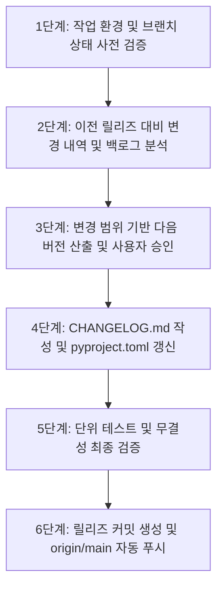

# AssetManager 릴리즈 관리 (Release AssetManager)

이 스킬은 AssetManager 프로젝트의 신규 릴리즈를 안전하고 일관된 절차에 따라 발행합니다.
직전 릴리즈 이후 main 브랜치에 머지된 모든 변경사항(병렬 브랜치 머지 포함)과 백로그(`done/`) 문서를 종합 분석하여, 사용자에게 변경 요약 보고 및 권장 버전을 제안하고 승인을 받은 뒤 CHANGELOG.md 및 pyproject.toml을 갱신하고 Git 커밋 및 푸시를 완료합니다.

---

## 릴리즈 워크플로우



---

### 1단계: 작업 환경 및 브랜치 상태 사전 검증
릴리즈를 시작하기 전, Git 작업 트리의 안전성을 확인합니다.

1. **현재 브랜치 확인**:
   ```powershell
   git branch --show-current
   ```
   - 결과가 `main`이 아닌 경우, 사용자에게 안내하고 릴리즈를 중단하거나 `main` 브랜치로 전환을 요청합니다.
2. **미커밋 변경사항 확인**:
   ```powershell
   git status --porcelain
   ```
   - 작업 디렉토리에 커밋되지 않은 파일(추적 중이거나 미추적 파일)이 남아있다면 릴리즈를 진행하지 않고 사용자에게 정리를 요청합니다.
- **완료 검증 조건 (Completion Criterion)**:
  - [ ] 현재 브랜치가 `main`임이 확인됨
  - [ ] 워킹 트리가 깨끗함(`working tree clean`)이 확인됨

---

### 2단계: 이전 릴리즈 대비 변경 내역 및 백로그 수집 (병렬 브랜치 포함)
이전 릴리즈 이후 변경된 모든 커밋과 완료된 백로그 문서를 수집합니다.

1. **직전 릴리즈 커밋 및 현재 버전 확인**:
   - `pyproject.toml`에서 현재 버전(`CURRENT_VERSION`) 추출
   - 직전 릴리즈 커밋 해시 탐색:
     ```powershell
     git log --grep="release:" -n 1 --format="%H %s"
     ```
2. **직전 릴리즈 이후의 커밋 및 머지 내역 전수 수집**:
   - 병렬 브랜치에서 작업 후 merge된 커밋들을 포함하여 조회:
     ```powershell
     git log <LAST_RELEASE_HASH>..HEAD --oneline
     ```
   - 머지 커밋 목록 별도 확인:
     ```powershell
     git log <LAST_RELEASE_HASH>..HEAD --merges --oneline
     ```
3. **관련 백로그 및 사양서(spec.md) 탐색**:
   - `.backlog/done/` 및 `.backlog/` 하위 디렉토리 중, 이번 변경과 연관된 피처 폴더 탐색
   - 해당 폴더 내 `spec.md`, `issues/` 문서의 상대 경로 확인 (예: `.backlog/done/<feature-slug>/spec.md`)
- **완료 검증 조건 (Completion Criterion)**:
  - [ ] 직전 릴리즈 커밋 해시와 현재 버전 확인 완료
  - [ ] 릴리즈 대상 커밋 목록 및 머지된 브랜치 내역 수집 완료
  - [ ] 각 기능별 연관 백로그 문서(`.backlog/done/<feature-slug>/spec.md` 등) 매핑 완료

---

### 3단계: 변경 범위 기반 다음 버전 산출 및 사용자 승인
수집한 변경사항을 분석하여 [Semantic Versioning (SemVer)](https://semver.org/lang/ko/) 원칙에 따라 다음 버전을 추천하고, 사용자에게 보고하여 승인을 받습니다.

1. **버전 추천 판정 기준**:
   - **Major (X.0.0)**: 기존 기능/DB 스키마/API의 하위 호환성을 깨뜨리는 근본적 아키텍처 변경
   - **Minor (X.Y.0)**: 새로운 기능(Feature) 추가, 신규 페이지/컴포넌트/엔드포인트 도입 (하위 호환성 유지)
   - **Patch (X.Y.Z)**: 기존 기능의 버그 수정(Fix), UI 스타일/사용성 미세 개선, 리팩토링, 사소한 성능 향상, 문서/의존성 변경
2. **사용자 보고 및 대화식 승인 (`ask_question`)**:
   - 보고 내용:
     - 현재 버전 및 추천 다음 버전
     - 병렬 머지된 브랜치/기능 목록
     - 변경사항 요약 (Added, Changed, Fixed 항목 초안)
     - 연관 백로그 링크 목록
   - `ask_question` 도구를 통해 다음 버전을 제안하고, 사용자가 승인하거나 다른 버전을 직접 입력/선택하도록 진행합니다.
- **완료 검증 조건 (Completion Criterion)**:
  - [ ] 사용자에게 변경 요약 및 권장 버전 보고 완료
  - [ ] 사용자가 최종 릴리즈 버전을 승인 또는 지정함

---

### 4단계: CHANGELOG.md 작성 및 pyproject.toml 갱신
사용자가 승인한 버전에 맞추어 프로젝트 파일들을 갱신합니다.

1. **CHANGELOG.md 업데이트**:
   - [Keep a Changelog](https://keepachangelog.com/ko/1.1.0/) 양식을 준수하여 최상단에 신규 버전 섹션 추가
   - 섹션 헤더: `## [X.Y.Z] - YYYY-MM-DD`
   - 분류 태그:
     - `### Added`: 새로 추가된 기능 및 백로그 링크
     - `### Changed`: 기존 기능의 동작 변경
     - `### Fixed`: 버그 수정 사항
   - 백로그 링크 예시: `([상세 스펙](.backlog/done/<feature-slug>/spec.md))`
2. **pyproject.toml 버전 변경**:
   - `version = "X.Y.Z"` 항목을 승인된 신규 버전으로 업데이트
- **완료 검증 조건 (Completion Criterion)**:
  - [ ] `CHANGELOG.md` 최상단에 신규 릴리즈 섹션이 올바른 양식으로 추가됨
  - [ ] `pyproject.toml`의 `version` 필드가 신규 버전 문자열로 변경됨

---

### 5단계: 단위 테스트 및 무결성 최종 검증
릴리즈 커밋 생성 전 전체 시스템이 정상 작동하는지 테스트를 실행합니다.

1. **백엔드 단위 테스트 실행**:
   ```powershell
   uv run pytest
   ```
   - 모든 테스트가 통과(PASS)해야 다음 단계로 진행할 수 있습니다.
   - 실패하는 테스트가 있을 경우 즉시 중단하고 사용자에게 보고합니다.
- **완료 검증 조건 (Completion Criterion)**:
  - [ ] `uv run pytest` 테스트가 0 에러로 전체 통과함

---

### 6단계: 릴리즈 커밋 생성 및 origin/main 자동 푸시
모든 검증이 완료되면 Git 커밋을 생성하고 원격 저장소로 푸시합니다.

1. **Git Staging 및 커밋**:
   ```powershell
   git add pyproject.toml CHANGELOG.md
   git commit -m "release: vX.Y.Z"
   ```
   *(참고: 이번 릴리즈와 함께 완료된 백로그 폴더 이동 커밋이 필요한 경우 함께 포함할 수 있습니다)*
2. **원격 저장소 푸시**:
   ```powershell
   git push origin main
   ```
3. **최종 보고**:
   - 릴리즈 완료 버전, 커밋 해시, CHANGELOG 반영 내역을 사용자에게 요약 안내합니다.
- **완료 검증 조건 (Completion Criterion)**:
  - [ ] `release: vX.Y.Z` 커밋 생성 완료
  - [ ] `origin main`으로 푸시 완료
